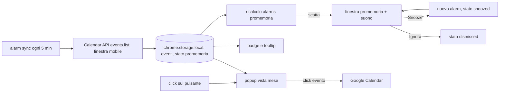

# Calendar Checker — Analisi preliminare

Nov 2, 2026 · @Matteo

## Contesto e obiettivo

Estensione Chrome (Manifest V3) per uso personale che mostra a colpo d'occhio gli eventi di Google Calendar e gestisce i promemoria con snooze, sul modello di Checker Plus for Google Calendar.

Stack: TypeScript, popup e finestra promemoria in Preact (signals), Vite, Tailwind CSS + DaisyUI, Vitest, approccio funzionale.

Angular e React sono stati valutati con tre scaffolder di confronto (`experiments/`). Preact vince sul peso del bundle del popup (8,8 kB gzip contro 29,7 kB di Angular e 68,9 kB di React), su una sola pipeline di build e sulle pagine come entry separate.

## Vincoli

| Vincolo | Scelta |
| --- | --- |
| Account | Uno solo, quello loggato in Chrome (`chrome.identity.getAuthToken`) |
| Permessi su Calendar | Sola lettura, scope `calendar.readonly` |
| Lingua | Solo italiano |
| Distribuzione | Privata, estensione caricata in locale |
| Monetizzazione | Nessuna |
| Aggiornamento dati | Polling periodico, nessun backend |

## Requisiti funzionali

### Calendari

- Si mostrano solo i calendari selezionati nelle impostazioni.
- Ogni calendario usa il colore fornito dall'API.

### Popup del pulsante

- Vista mese, unica vista disponibile.
- Gli eventi appaiono come chip o pallini colorati secondo il calendario.
- Il click su un evento apre Google Calendar su quell'evento (`htmlLink`).
- Si apre subito dai dati in cache e si aggiorna in background.

### Prossimo evento (badge e tooltip)

- Si escludono gli eventi all-day e quelli rifiutati (`responseStatus: declined`).
- Badge sull'icona, mostrato solo se mancano meno di 2 giorni:
  - `ora` durante l'evento in corso;
  - `Xm` sotto l'ora;
  - `Xh` sotto le 24 ore;
  - `Xg` fino a 48 ore;
  - niente oltre.
- Tooltip sull'icona: titolo e orario del prossimo evento.

### Promemoria

- Si usano i promemoria configurati su Google Calendar: override dell'evento, altrimenti `defaultReminders` del calendario. Vale anche per gli eventi all-day.
- Allo scatto si apre una finestra popup con una card per evento: titolo, orario, pulsanti di snooze.
- Più promemoria simultanei finiscono nella stessa finestra.
- Suono singolo dell'app allo scatto, non configurabile.
- All'avvio di Chrome si mostrano i promemoria scattati mentre era chiuso, solo per eventi non ancora finiti (in corso o futuri).
- La finestra con più card ha un pulsante "Ignora tutti".

### Snooze

- Tempi fissi: 5, 10, 15, 30 minuti, 1 ora, 4 ore.
- Relativi all'inizio: -10 min, -5 min, all'inizio. Compaiono solo se cadono ancora nel futuro.
- "Ignora" chiude il promemoria in modo definitivo.

### Aspetto

- Dark mode automatica, segue il tema di sistema.

## Architettura tecnica

Tutto gira nel client: il service worker sincronizza gli eventi, li salva in storage e programma un alarm per ogni promemoria.



| Componente | Ruolo |
| --- | --- |
| Service worker | Sync, ricalcolo alarms, aggiornamento badge e tooltip |
| Popup (Preact) | Vista mese dai dati in cache |
| Finestra promemoria (Preact) | Card, snooze, suono; aperta con `chrome.windows.create({ type: 'popup' })` |
| Pagina opzioni | Selezione dei calendari |
| `chrome.storage.local` | Cache eventi, stato promemoria |
| `chrome.storage.sync` | Impostazioni |

Note di implementazione:

- `events.list` con `singleEvents=true`: le ricorrenze le espande l'API.
- Sync a finestra mobile, senza `syncToken`: ogni 5 minuti, per ogni calendario selezionato, si scaricano gli eventi dal primo del mese corrente a oggi + 60 giorni e la cache viene sostituita per intero. Motivo: `syncToken` non si combina con `timeMin/timeMax` e per un solo utente il risparmio di dati non serve. Mesi fuori finestra: il popup li scarica al momento della navigazione.
- Scheduling: un solo alarm "prossimo promemoria", ricalcolato da una funzione pura a ogni cambio di stato (sync, snooze, ignora), più due alarm fissi: sync ogni 5 minuti e aggiornamento badge ogni minuto.
- Avvio di Chrome (`onStartup`, `onInstalled`): non ci si affida agli alarm, che possono andare persi. Si legge lo stato salvato, si fanno scattare tutti i promemoria `pending` con orario passato e relativo evento non ancora finito, in un'unica finestra, poi si riprogramma l'alarm.
- Stato dei promemoria: solo il service worker lo scrive. Popup e finestra promemoria leggono dallo storage (`storage.onChanged`) e inviano comandi con `runtime.sendMessage` (`snooze`, `dismiss`, `dismissAll`). Così non ci sono scritture in conflitto tra sync, snooze e ignora.
- Errori di sync: su 401 si rimuove il token (`removeCachedAuthToken`) e si riprova una volta; su errori di rete o 5xx la cache resta valida e si riprova al sync successivo.
- Chiave dello stato promemoria: `eventId + start + minuti`, così le occorrenze ricorrenti restano distinte.
- Il service worker MV3 viene terminato quando è inattivo: nessuno stato in memoria, solo storage e alarms.
- Eventi all-day: campo `date` invece di `dateTime` (fine esclusiva); fusi orari gestiti con `Intl` e funzioni pure, senza librerie.
- Promemoria: si considerano solo quelli con metodo `popup`; quelli `email` vengono ignorati.
- Calendari sincronizzati: fino alla pagina opzioni (slice 7) quelli con `selected: true` su Google Calendar.
- Sync tollerante ai fallimenti per calendario: se un calendario dà errore ne restano gli eventi in cache, gli altri vengono sostituiti per intero. Se fallisce la lista dei calendari la cache non viene toccata.

## Struttura del codice

```
src/
  core/        TS puro, senza chrome.* né Preact: calcolo badge, promemoria effettivi,
               snooze, chiavi di stato, finestra di sync, mapping eventi
  platform/    wrapper sottili su chrome.* (storage, alarms, identity, windows, action)
  background/  service worker: orchestra core + platform
  ui/          Preact: tre entry HTML (popup, promemoria, opzioni)
```

- `core/` contiene tutta la logica di dominio come funzioni pure e si testa con Vitest senza browser: è dove i bug su fusi orari e snooze sono più probabili.
- `platform/` è l'unico punto che conosce le API di Chrome.
- Date e fusi orari: `Intl` e funzioni pure in `core/`, senza librerie. Gli `dateTime` dell'API portano già l'offset; gli eventi all-day usano `date`.
- Build: Vite multi-page (`popup.html`, `reminder.html`, `options.html`) più il service worker come entry con nome file fisso (`background.js`).

## Piano di sviluppo

Per slice verticali, partendo da ciò che può bloccare il progetto:

1. **Setup**: Vite + Preact + Tailwind/DaisyUI + Vitest, manifest, build caricabile da `chrome://extensions`.
2. **OAuth end-to-end**: `getAuthToken` e lista dei calendari in console.
3. **Sync e storage**: finestra mobile, cache, `core/` con test.
4. **Badge e tooltip**: alarm di sync e alarm ogni minuto.
5. **Promemoria e snooze**: alarm unico, finestra, suono, ripresa all'avvio.
6. **Popup vista mese**.
7. **Pagina opzioni** (selezione dei calendari; fino ad allora, lista fissa).

Ogni slice si chiude con un commit.

## Installazione e OAuth per uso privato

Nessuna pubblicazione: l'estensione si carica da `chrome://extensions` con Modalità sviluppatore e "Carica estensione non pacchettizzata".

1. Creare un progetto GCP e abilitare la Google Calendar API.
2. Configurare la consent screen con lo scope `calendar.readonly` e metterla In production senza verifica: l'avviso "app non verificata" si accetta una volta e il consenso non scade. In Testing scadrebbe ogni 7 giorni.
3. Inserire una `"key"` nel `manifest.json` per avere un ID estensione stabile.
4. Creare un client OAuth di tipo "Chrome extension" legato a quell'ID.

Costi: zero.

**Stato attuale (da risolvere appena possibile):** la consent screen è ancora in **Testing**, con la propria email come utente di prova, perché il pulsante "Pubblica app" risulta disabilitato. Si sospetta che Google richieda nel Branding dominio, homepage, privacy policy e termini di servizio. In Testing il consenso scade ogni 7 giorni e va riautorizzato. Da fare: preparare pagine statiche (es. GitHub Pages, oppure un dominio proprio), compilare il Branding e passare a In production. Resta da verificare se Google accetta un dominio `github.io` senza verifica in Search Console.

ID estensione stabile: `cbcogelbeighnelkmhamflecdgjnflic` (derivato dalla `key` nel manifest).

## Fuori perimetro ed evoluzioni future

Esclusi dall'MVP: multi-account, creazione e modifica eventi, viste diverse dal mese, "non disturbare", scelta del suono, lingue diverse dall'italiano, notifiche push via `watch`.

Per un'eventuale pubblicazione servirebbero:

- account sviluppatore Chrome Web Store, 5 $ una tantum;
- dominio verificato in Search Console (es. `matteofeliciani.it`) con homepage e privacy policy;
- verifica OAuth per scope sensitive, gratuita, con un video demo;
- un nome che non contenga "Google".
